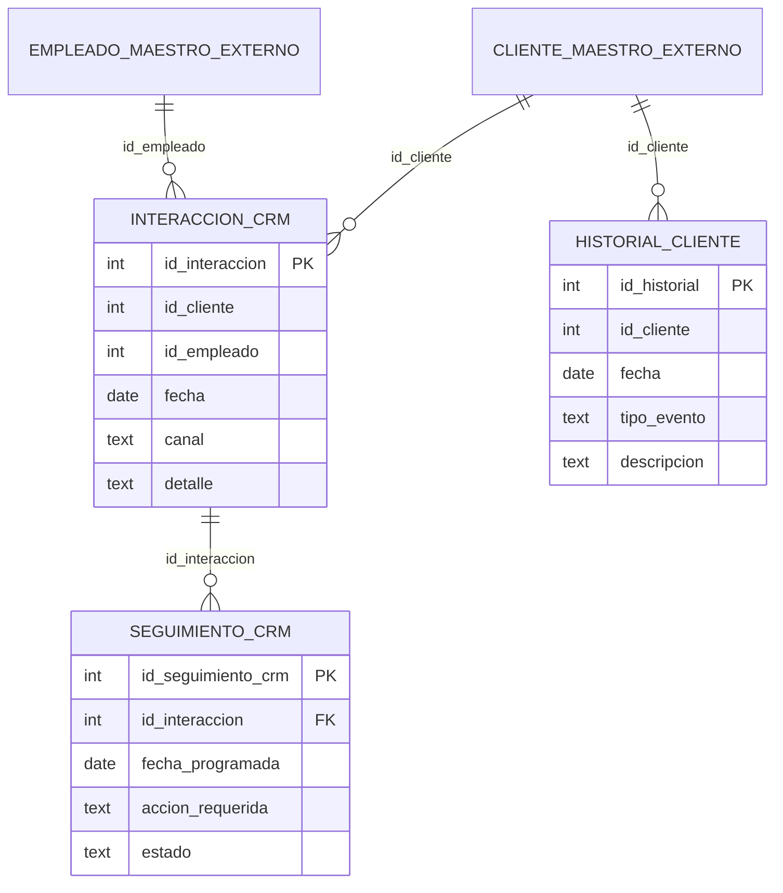

# Esquema `crm`

El CRM es dueño de tres tablas. No crea ni modifica tablas de otros módulos y no usa
`synchronize`. El DDL de referencia para un PostgreSQL local está en
`database/init/01_schema.sql`.

## Diagrama lógico



`CLIENTE_MAESTRO_EXTERNO` y `EMPLEADO_MAESTRO_EXTERNO` son relaciones **lógicas**.
El CRM no crea claves foráneas contra ellos.

- **Cliente real:** `"master"."cliente"` en la base `si2_22026`. El adaptador
  `DbClienteMaestroAdapter` lo consulta en solo lectura con
  `CLIENTE_MAESTRO_MODE=db`.
- **Empleado:** todavía no existe el esquema `RRHH` en `si2_22026`. Se usa
  `EMPLEADO_MAESTRO_MODE=mock` (IDs 1..3) hasta que RRHH exponga su tabla.

### Mapeo del maestro de clientes

| Columna `"master"."cliente"` | Campo del puerto/API |
|---|---|
| `id_cliente` | `idCliente` |
| `rut` | `rut` |
| `nombre` | `nombre` |
| `correo` | `email` |

`telefono` y `direccion` existen en la tabla maestra, pero no forman parte del
contrato mínimo actual del CRM.

## `crm.interaccion_crm`

Registra un contacto comercial con un cliente.

| Columna | Tipo | Nulo | Restricción | Descripción |
|---|---|---|---|---|
| `id_interaccion` | integer | no | PK, identity | Identificador interno |
| `id_cliente` | integer | no | — | ID del maestro de clientes |
| `id_empleado` | integer | no | — | ID del maestro de empleados |
| `fecha` | date | no | default `CURRENT_DATE` | Fecha del contacto |
| `canal` | text | no | `btrim(canal) <> ''` | `whatsapp`, `email`, etc. |
| `detalle` | text | no | `btrim(detalle) <> ''` | Detalle del contacto |

## `crm.seguimiento_crm`

Registra una acción pendiente asociada a una interacción.

| Columna | Tipo | Nulo | Restricción | Descripción |
|---|---|---|---|---|
| `id_seguimiento_crm` | integer | no | PK, identity | Identificador interno |
| `id_interaccion` | integer | no | FK → `interaccion_crm` | Interacción origen |
| `fecha_programada` | date | no | — | Fecha planificada de la acción |
| `accion_requerida` | text | no | `btrim(accion_requerida) <> ''` | Acción a realizar |
| `estado` | text | no | check de estados | Estado actual |

Estados permitidos:

- `pendiente`
- `en_proceso`
- `completado`
- `cancelado`

El API siempre crea los seguimientos en `pendiente`. No hay transiciones rígidas en
este sprint: cualquier estado permitido puede asignarse mediante `PATCH`.

## `crm.historial_cliente`

Vista 360° de eventos del cliente. No tiene FK porque el maestro de clientes es
externo.

| Columna | Tipo | Nulo | Restricción | Descripción |
|---|---|---|---|---|
| `id_historial` | integer | no | PK, identity | Identificador interno |
| `id_cliente` | integer | no | — | Cliente afectado |
| `fecha` | date | no | default `CURRENT_DATE` | Fecha del evento |
| `tipo_evento` | text | no | `btrim(tipo_evento) <> ''` | Tipo de evento |
| `descripcion` | text | no | `btrim(descripcion) <> ''` | Texto legible |

Tipos de evento generados por el CRM:

| Tipo | Origen |
|---|---|
| `contacto_comercial` | `POST /api/interacciones` |
| `seguimiento_creado` | `POST /api/seguimientos` |
| `seguimiento_actualizado` | `PATCH /api/seguimientos/:id/estado` |
| `cliente_actualizado` | Evento inbound `cliente.actualizado` |

Todos los registros se escriben en la misma transacción que la operación de negocio,
excepto `cliente_actualizado`, que es un efecto del consumo de un evento.

## Datos de demostración

Conteos verificados después de la última ejecución del smoke test en `si2_22026`:

- `interaccion_crm`: 12
- `seguimiento_crm`: 12
- `historial_cliente`: 19

Los registros base originales eran `10/10/10`. El smoke test agrega registros nuevos
con el prefijo `[DEMO]`; las interacciones existentes usan `id_cliente` `1..10`,
`id_empleado` `1`, canales `whatsapp`/`email` y fecha `2026-10-25`. Los seguimientos
están programados para `2026-10-27`.

El maestro `"master"."cliente"` contiene 10 clientes demo con IDs `1..10`.
Se pueden recrear de forma idempotente con:

```bash
cd backend
npm run seed:master
```

## Operación

- `synchronize: false` y `migrationsRun: false` son obligatorios: la base es
  compartida con otros grupos.
- El esquema por defecto es `crm`.
- `CLIENTE_MAESTRO_MODE=db` consulta `"master"."cliente"`; no escribe en el
  maestro.
- `EMPLEADO_MAESTRO_MODE=mock` se mantiene mientras no exista `RRHH`.
- Las fechas se comparan en la zona `TZ` del servidor (por defecto
  `America/Santiago`).
- La conexión a Neon usa SSL con `rejectUnauthorized` configurable.

## Pendientes

- Maestro real de empleados (`"RRHH"."RRHH_empleado"`).
- RBAC para proteger el historial 360°.
- `fecha_completado` para medir tiempo de respuesta real.
- Outbox transaccional si se exige entrega garantizada de eventos.
